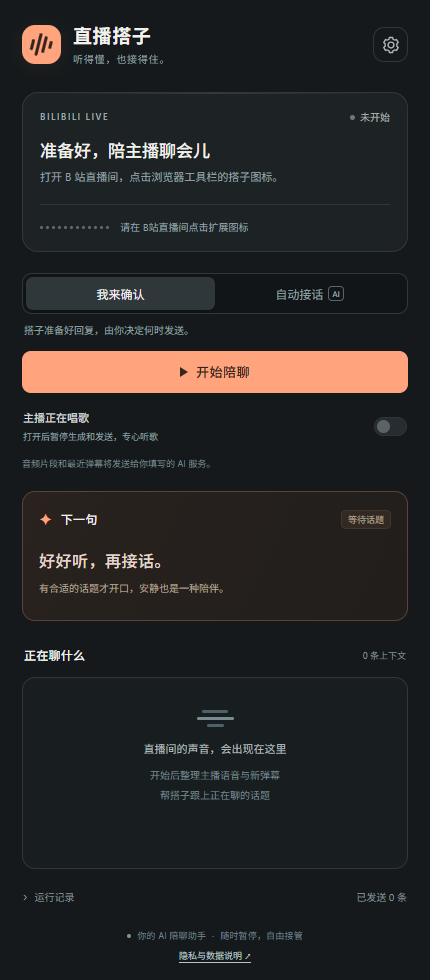

# 直播搭子

给 B 站观众使用的 Chrome / Edge 侧边栏插件。听主播声音、读取新弹幕，结合上下文生成简短接话；支持人工发送和有倒计时的自动发送。

**当前为公开测试版，尚未上架 Chrome Web Store。** 使用者需要自行填写 AI API Key，API 用量由所选服务商计费。代码按 [MIT 许可证](LICENSE) 开放。

[下载安装包](https://github.com/SCUliujiacheng/live-companion/releases/tag/v0.1.1-beta.1) · [隐私政策](PRIVACY.md) · [反馈问题](https://github.com/SCUliujiacheng/live-companion/issues) · [Chrome 商店提交指南](store/REVIEW-CHECKLIST.md)



## 安装（不需要部署服务器）

1. 从 [GitHub Release](https://github.com/SCUliujiacheng/live-companion/releases/tag/v0.1.1-beta.1) 下载并解压 `live-companion.zip`，保留整个解压目录。也可直接使用项目中的 `extension` 文件夹。
2. Chrome 地址栏输入 `chrome://extensions`；Edge 输入 `edge://extensions`。
3. 打开「开发者模式」，选择「加载已解压的扩展程序」，选中包含 `manifest.json` 的文件夹。
4. 将「直播搭子」固定到浏览器工具栏。打开目标 B站直播间，使用自己的账号正常登录，点击直播搭子图标。
5. 在侧边栏填写 API 设置，保存。浏览器会询问是否允许访问你填写的服务域名。
6. 选择「确认后发送」试用，或主动选择「自动接话」，再点击「开始监听」。开始时请保持目标直播间标签页打开，并已播放直播声音。

支持 Chrome 116+；建议用当前稳定版 Chrome。Edge 使用相同扩展接口，但尚未在 Edge 实机验证。

## API 怎么填

| 设置 | 默认值 |
| --- | --- |
| 聊天 Base URL | `https://api.openai.com/v1` |
| 聊天模型 | `gpt-4.1-mini` |
| 语音转写 Base URL | `https://api.openai.com/v1` |
| 语音转写模型 | `gpt-4o-mini-transcribe` |
| API Key | 由你在插件中填写，源码和安装包没有密钥 |

两组 API 可独立配置。同一 OpenAI Key 可分别填入两组。换聊天服务商时，语音转写可以继续使用 OpenAI。

自定义服务需兼容对应的 OpenAI HTTP 格式：聊天为 `POST /chat/completions`，转写为 `POST /audio/transcriptions`（multipart WAV 文件，返回 JSON 的 `text`）。Base URL 填到 `/v1` 等公共前缀，不要把 `/chat/completions` 完整路径填进去。只支持 HTTPS 或 localhost / 127.0.0.1 / ::1 的 HTTP。非兼容服务需要另外增加适配器；不能只改模型名字就保证可用。

「测试聊天」会发一条很短的真实请求，产生少量 API 用量。「检查转写连接」只检查 `/models` 认证和所填模型是否可见，不代表已验证音频转写；有的兼容服务不提供模型列表，需根据该服务文档判断。实际转写在开始监听后才进行。

默认密钥只保留在浏览器会话中，关闭浏览器后需重新输入；普通设置会保存。勾选「本机保存密钥」后，密钥存入扩展的本地存储，**该存储不是加密保险箱**。取消勾选并保存会清除磁盘中保存的密钥。密钥不会放入直播页面，不读取 B站 Cookie，不同步到浏览器账号。

设置中的「清除本机设置与密钥」会停止监听，清除本机设置、密钥、会话文字和日志，并撤销可选 API 站点权限。普通「停止监听」会保留当前会话的文字供查看，直至清除或浏览器会话结束。

音频片段和近期弹幕会发送到你填写的 AI 服务。插件不建远程后台，也不将直播音频保存成文件。API 用量由所选服务计费，ChatGPT 订阅不代替 API 额度。

## 怎样聊得自然

- 在「我的昵称」填写你当前 B站昵称，帮助识别自己的弹幕。
- 语气可写「像轻松聊天，少用感叹号，接梗就好，不尬夸」。直播间备注只填确认过的事实和称呼。
- 默认至少间隔 45 秒、每条最多 30 字；这只是上限控制，不会每 45 秒固定发一条。模型可选择沉默。
- 自动模式先展示 5 秒倒计时，可取消；「暂停接话」会取消生成与待发回复，「停止监听」还会释放音频捕获。
- 主播换话题后，旧回复会作废；自己的弹幕和主播念自己的弹幕尽量不触发循环。
- 主播唱歌时可直接开启「唱歌中」。自动场景判断基于转写和弹幕，不能可靠区分所有歌词、背景音乐或说话人。
- 准备手动打字时，插件发现输入框已有内容就拒绝覆盖。发送未确认时会暂停，不会反复点击发送。

## 当前验证范围

已提供自动化测试覆盖 API 配置与请求、密钥不进入公开配置、超时取消、冷却、复读、自我回声、语音分段、暂停与过期回复，以及模拟直播页面上的读取/发送保护。浏览器检查使用隔离 Chromium 和模拟页面，测试过程没有向真实直播间发消息。

**真实 OpenAI 转写、真实模型回复质量、你当前 B站账号的实际发送，需填入自己的 Key 后试用确认。** B站网页结构会变化，DOM 适配不等于官方发送接口。若提示找不到输入框或弹幕区域，停止监听并更新适配。直播流本身的延迟、分段转写和 API 响应也会带来数秒延迟，不是零延迟语音助手。

## 开发与打包

无需构建即可加载 `extension/`，开发测试使用 Node.js 20+：

```powershell
npm test
npm run check
npm run package
```

DOM 和浏览器测试额外使用 Playwright；可通过 `NODE_PATH` 指向已安装的 Playwright，通过 `LIVE_COMPANION_BROWSER` 指定 Chromium 可执行文件。不安装 Playwright 时 DOM 测试会明确跳过，其余测试不需要第三方包。

设计与职责见 `docs/design.md`，执行清单见 `docs/implementation-plan.md`。

## 发布与商店分发

GitHub Release 的 `live-companion.zip` 用于手动解压安装；`live-companion-chrome-web-store.zip` 的根目录含 `manifest.json`，用于 Chrome Web Store 开发者后台上传。商店文案、权限说明、截图和提交前检查在 `store/`。

商店开发者注册、一次性注册费、身份/账号要求及审核由发布者在 Google 后台完成。本仓库及上传包不表示 Google 已审核或认可。本项目与 B站、Google、OpenAI 无官方隶属关系。

接口参考：[Chrome 标签页音频捕获](https://developer.chrome.com/docs/extensions/reference/api/tabCapture)、[Chrome 后台录音方式](https://developer.chrome.com/docs/extensions/how-to/web-platform/screen-capture)、[OpenAI 语音转写](https://developers.openai.com/api/docs/guides/speech-to-text)。
